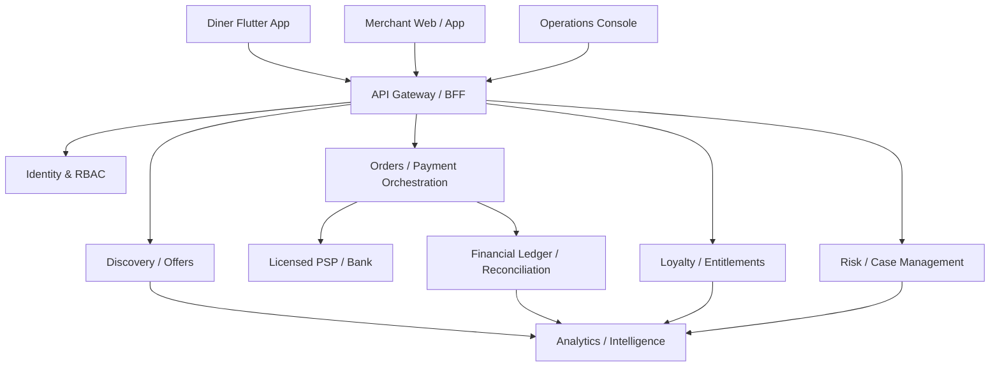

# OFF-PEAK — Product Backlog, System Architecture & Launch Design

**Version:** 1.0 — architecture baseline, 11 November 2026  
**Status:** DESIGN / NOT RELEASE-AUTHORISED  
**Initial geography:** Kathmandu Valley, Nepal (first dense pilot cluster; expand to Kathmandu, Lalitpur and Bhaktapur)  
**Positioning:** Restaurant-first demand optimisation, real-time offers, verified payments, and restaurant-specific loyalty.  
**Product owner:** Divya Kunj Bariyait  
**Relationship to previous work:** Off-Peak concept; build after the current B2B release milestone. ONLY1 is a separate later priority.

> **Operating principle:** Restaurants control economics; diners get genuine discounts and earned benefits; Off-Peak earns for commercial value delivered. No unverified transaction, reward, payout or penalty may be treated as final.

## 0. Decision register

| ID | Decision | Status |
|---|---|---|
| D-001 | Restaurant-first B2B2C product; diner app remains free | **Locked** |
| D-002 | Demand-based, time-bound deals, manually controlled or merchant-approved suggested | **Locked** |
| D-003 | Restaurant-specific Silver, Gold and Platinum loyalty | **Locked** |
| D-004 | Rewards funded by each participating restaurant; eligible benefits visible upfront | **Locked** |
| D-005 | Gold: proposed 50% off one eligible item per month with monetary cap | **Provisional** |
| D-006 | Platinum: proposed one selected free meal per month, not unbounded menu access | **Provisional** |
| D-007 | Silver: proposed monthly low-cost side/drink reward | **Provisional** |
| D-008 | Merchant chooses an annual plan or a 15% completed-payment commission plan; no double charging | **Locked concept; commercial amounts/terms unvalidated** |
| D-009 | Commission base: actually collected eligible discounted payment, excluding refunded amounts and explicit non-commissionable components | **Provisional contract definition** |
| D-010 | Payments and settlements via a suitably authorised Nepal payment partner; never assume Off-Peak can hold client funds | **Mandatory prerequisite** |
| D-011 | Restaurant bypass and user collusion are material fraud risks; transparent proportional investigation and enforcement | **Locked** |
| D-012 | First pilot in one dense neighbourhood with 5–10 partners | **Recommended, subject to validation** |
| D-013 | No production release merely because code or tests passed; independent launch gates required | **Locked** |

### Open executive decisions (must resolve before implementation freeze)

1. Legal contracting entity, ownership and jurisdiction; Nepal counsel review.
2. Licensed provider and whether it offers merchant-level split settlement, marketplace collection, reversals and APIs.
3. Annual plan price and service/volume terms; no amount approved yet.
4. Whether all annual-plan dining payments must be processed or merely verified through a provider-supported flow.
5. Gold/Platinum qualifying spend, visit frequency, grace period and caps by restaurant category.
6. What happens to existing earned rewards if a restaurant pauses, leaves, runs out of stock or closes.
7. Commission treatment for VAT/taxes, tips, payment fees, refunds, partial refunds, reward redemptions and cash sales.
8. Which demand/occupancy data merchants can supply reliably in pilot.

## 1. Product thesis and market assumptions

### 1.1 Problem

Restaurants have quiet periods and limited ability to predict marginal demand. Blanket discounts can subsidise customers who would have visited anyway. Marketing tools may show impressions rather than revenue or retention. Diners want real, understandable offers and loyalty value without prepaid deposits or membership fees.

### 1.2 Solution

- **Acquire:** restaurants publish real, limited-time, capacity-aware discounts.
- **Convert:** users find a nearby offer, claim/book, dine, pay through a supported verified route, and receive a receipt.
- **Retain:** eligible verified visits progress restaurant-specific Silver, Gold and Platinum membership; rewards are merchant-funded and budgeted.
- **Optimise:** merchant dashboard shows attributed sales, retained diners, variable contribution estimates and demand-aware offer suggestions with explanations and uncertainty.
- **Protect:** payment and event ledger, idempotency, reconciliation, fraud signals, investigations, and fair appeals.

### 1.3 Competitive baseline — BiteOut (publicly reported, November 2026)

BiteOut publicly describes restaurant discovery, booking and staff-visible redemption, fixed NPR 100/200/500 deals and timed availability, venue dashboards, verified reviews, short videos, personalisation and visit badges. Its published October 2026 partner terms offer annual merchant plans (NPR 30,000 Partner / NPR 80,000 Spotlight) and paid Boosts rather than standard sales commission. This is a **time-sensitive research baseline**, not a claim about undisclosed functionality or actual performance. Its partner terms also describe exclusivity; do not solicit breach of existing agreements.

**Potential distinction, to prove:** closed-loop merchant profitability + merchant-specific financial loyalty + real-time explainable demand optimisation. Do not claim unique or superior performance until tested.

### 1.4 Business hypotheses and validation

| Hypothesis | Test | Pass criterion before expansion |
|---|---|---|
| Merchants accept 15% of verified discounted payment | 20 interviews, signed pilot offers | At least 5 willing paid pilots with clear economics |
| Merchants will fund tier rewards | Per-merchant reward budgets and agreements | At least 3 merchants opt in with positive projected unit economics |
| Offers generate incremental visits | Randomised holdouts / matched time slots where feasible | Positive incremental contribution with disclosed uncertainty |
| Loyalty increases retention | Merchant-level eligible cohorts and control | Material improvement in repeat contribution, not just visits |
| App payments are feasible | Provider technical/commercial due diligence | Written provider agreement and proven settlement sandbox |

## 2. Personas and stakeholder priorities

1. **Owner/operator (economic buyer):** monitors incremental contribution, controls offers, rewards, budgets, staff access, settlement and disputes.
2. **Manager:** adjusts approved offer windows, inventory, booking capacity and service operations.
3. **Cashier/server:** validates visit and redemption, assists customer, cannot set pricing or alter ledger.
4. **Diner:** discovers offers, pays securely, tracks status, claims earned rewards, resolves disputes.
5. **Off-Peak operator:** oversees onboarding, compliance, merchant support, risk cases and evidence.
6. **Payment partner:** confirms money movement, handles regulated collection/settlement, reversals and contractual disputes.

## 3. Commercial model and unit economics

### 3.1 Merchant plan options

**Performance:** zero annual fee; 15% on eligible completed paid transactions attributed to Off-Peak. Clear separate provider processing charges as contractually agreed. No commission on a genuinely free reward redemption, except on an additional eligible paid bill if the contract explicitly provides it.

**Annual:** fixed annual fee (TBD after research), no 15% transaction commission on covered sales. Transaction verification remains necessary for loyalty, analytics and anti-fraud. Specify fair-use/volume boundaries **before sale**; never silently change terms. Merchant may choose only one active plan per location; planned switching/payout adjustments must be explicit.

**Commission example:** menu bill NPR 1,000; valid 15% discount => collected eligible amount NPR 850; Off-Peak gross commission NPR 127.50; restaurant contractual share NPR 722.50 before provider fees, tax treatment and meal costs. Use integer minor units / explicit rounding policy. This is **gross revenue**, not profit.

**Annual vs commission break-even:** `annual_price / (0.15 * average_eligible_payment)` verified transactions per year, ignoring variable operating costs. For annual NPR 30,000 and average eligible payment NPR 850, threshold ≈ 236 transactions/year. Annual NPR 30,000 is an illustration/competitor benchmark, **not approved Off-Peak pricing**.

### 3.2 Merchant contribution model

For each eligible visit:

`merchant_contribution = actually_collected_bill - discount_already_reflected_in_collection? (NO: do not deduct twice) - commission - provider_fee_borne_by_merchant - incremental_food_and_service_cost - reward_cost_if_redeemed`

More directly: `merchant_contribution = net_cash_settlement_before_fixed_overhead - incremental_cost_of_fulfilment - merchant_funded_reward_cost`, accounting explicitly for payment fees, taxes and refund adjustments.

**Incremental contribution** requires estimated counterfactual visits; it is not equal to attributed revenue. Report observed numbers separately from estimated lift, with confidence intervals and sample-size warnings. No guarantee of incremental sales.

### 3.3 Reward economics

Rewards are optional merchant-enabled programs with **predeclared eligible items, stock, schedule, monthly budget and customer entitlements**. Actual cost is ingredient + incremental labour/packaging/servicing costs, not menu retail price. Restaurants can pause *future earning* when their budget is exhausted, but must honour already-issued valid entitlements or provide an agreed fair substitute/refund arrangement.

Suggested tier defaults (configurable within platform safeguards):

| Tier | Earn | Retain | Merchant-funded benefit |
|---|---|---|---|
| Newcomer | First qualifying payment | N/A | Public deals only |
| Silver | 3 eligible visits on 3 days in 60 days | 2 visits / rolling 60 days | One eligible low-cost add-on / month |
| Gold | 8 visits across >=6 weeks in 120 days | 3 visits / rolling 90 days | One selected item 50% off / month, rupee cap |
| Platinum | 20 visits across >=12 weeks in 180 days | 5 visits / rolling 120 days | One selected free meal / month, cost and inventory cap |

These are **test hypotheses**, not universal requirements. Fine dining and quick-service categories need separate calibrated parameters. Publish precise, understandable thresholds for each participating restaurant; changes affect new earning periods, not retrospectively issued entitlements. Grace period and dispute process required. Max one qualifying visit per calendar day and one eligible dining occasion; exclude self-pay, split-bill gaming, refunds and reversals. Avoid arbitrary spend-only gamification that encourages unhealthy spending.

### 3.4 Reward exposure constraints

- `reserved_reward_cost + prospective_new_entitlements_cost <= approved_reward_budget` under a transaction lock or serialised allocation.
- A reward must exist as an immutable entitlement instance with an expiry and reservation/consumption state.
- Redeemed rewards are idempotent, exactly one consumption per entitlement, time/location/account bound.
- Account-level redemption quotas, restaurant-level stock and daily service capacity are distinct limits.
- No hidden minimum purchase for a promoted **free** meal. Any conditions disclosed up front and reviewed under Nepal consumer law.

## 4. End-to-end user journeys

### 4.1 Diner discovery to completed purchase

1. Guest opens map/feed, sees transparent genuine standard price, current offer, availability and eligibility.
2. Guest may browse; authenticated user claims a short-lived reservation (server-stored quote/version and expiry).
3. Restaurant receives booking forecast and capacity impact; reservation is not yet a paid sale.
4. On arrival, cashier presents/validates an order-specific payment request with the accepted offer.
5. Payment provider collects funds; backend verifies authoritative provider state, amount, currency, restaurant, order ID and dedupe key.
6. Payment transitions to `SUCCEEDED`; server posts balanced ledger entries and commission obligation; reward earning event follows from committed payment.
7. Diner sees receipt and loyalty progress; merchant sees settlement state; nightly reconciliation verifies external transactions.
8. Failure, refund or dispute uses a separate reversal record, never deletes financial history.

### 4.2 Merchant onboarding

1. Business identity, address, legal owner/contact, branches, settlement beneficiary and documents captured; minimum data only.
2. Identity verification, bank/PSP merchant onboarding and sanctions/compliance gates per provider and applicable law.
3. Merchant accepts plan, commission rules, fraud/appeal policy and customer offer obligations.
4. Owner configures menu, accepted price source, staff roles, opening hours, capacity, optional loyalty budget and deal constraints.
5. Staff train on payment flow, deal handling and customer complaints; go-live checklist and test transaction.
6. Admin approval and verified merchant `ACTIVE` status; no live deal before prerequisites.

### 4.3 Merchant-driven offer lifecycle

`DRAFT -> SIMULATED -> APPROVED -> SCHEDULED -> ACTIVE -> PAUSED/EXPIRED -> ARCHIVED`.

An offer contains immutable published version, restaurant/location, eligible items, baseline price source, discount type and cap, window/timezone `Asia/Kathmandu`, weekly recurrence, capacity, booking limits, minimum eligible purchase, cumulative stacking policy, merchant approval, and customer terms. Existing accepted bookings retain their quote unless explicitly cancelled with compliant customer remedy.

### 4.4 Loyalty and redemption lifecycle

`UNQUALIFIED -> SILVER -> GOLD -> PLATINUM` with independent rolling qualification and maintenance calculations; `GRACE -> DOWNGRADED` on expiry. Maintain event-sourced eligibility provenance; calculate tier projections from verified events. Reward lifecycle: `RESERVED_BUDGET -> ISSUED -> CLAIMED -> REDEEMED` or `EXPIRED/CANCELLED`; prevent duplicate issuance via `(merchant, member, program, period, benefit)` unique constraint.

### 4.5 Complaint, investigation and appeal

Customer reports bypass/unhonoured deal with booking, time, merchant, optional receipt; safe evidence intake. Merchant can respond. Risk team records evidence, case transitions, communication and resolution. No automatic fines, fund seizure or unreviewable permanent bans. Serious confirmed abuse permits proportionate suspension, termination and lawful recovery subject to contract/legal advice. Preserve earned customer entitlements appropriately.

## 5. Logical architecture

**Deployment bias:** Start as a modular monolith with strict module boundaries, not a premature distributed microservice fleet. Separate workers for settlement reconciliation, projections, notifications and forecast jobs. The payment ledger and risk case services are high-integrity modules with dedicated permissions and transactional invariants. Split into services later if scaling evidence justifies it.

### 5.1 Reference technology stack (proposed, not mandated)

- **Diner:** Flutter for Android/iOS; accessible responsive discovery web with universal links; no Apple/Google paid distribution until pilot funding and app requirements are ready.
- **Merchant:** Next.js + TypeScript web dashboard / responsive PWA; optional mobile wrapper later.
- **Backend:** Rust + Axum + SQLx/Tokio (reuses Only1 experience), or Go for simplicity; choose one primary backend. Do **not** merge Only1 payment logic without independent security review.
- **Source of truth:** PostgreSQL, transactional constraints, row-level tenancy defence, migration tests.
- **Cache/ephemeral:** Redis for rate limits/caches; never source of truth for money or entitlements.
- **Events:** Postgres transactional outbox + durable worker and dedup inbox; external broker only if throughput merits.
- **Media:** object storage with signed uploads, virus/content checks and derivative CDN; merchant ownership rights.
- **Observability:** OpenTelemetry traces, structured logs, Prometheus metrics, error monitoring; never log secrets/PII/payment tokens.
- **Intelligence:** Python analytical jobs or SQL-based rules first; versioned models and offline training only after adequate data. Distinct inference service if justified.
- **Infrastructure:** containerised managed Postgres, managed secrets, CI/CD, separated dev/staging/prod; backups with restore drills.

### 5.2 Bounded contexts

| Module | Owns | Forbidden shortcut |
|---|---|---|
| Identity & tenancy | accounts, merchants, staff RBAC, sessions | Trust client merchant ID |
| Catalog | locations, menu, price history, media | Mutable retroactive prices |
| Offers | versioned quotes, windows, capacities | Client decides discount |
| Orders | checkouts, line items, tax calculation | Payment status from UI callback alone |
| Payments | provider intents/events, verification | Client-side provider signature verification |
| Ledger & settlement | balanced journal, commission, payable, payouts, reversals | Overwrite financial row |
| Loyalty | tier rules, qualified events, reward inventory | Advance tier on reservation alone |
| Risk | signals, rules, cases, evidence and appeals | Blacklist from one weak model score |
| Intelligence | demand forecasts, experiments, explanations | Unapproved auto-changing price |
| Notifications | templated push/SMS/email, consent | Broadcast personal spending history |
| Operations | review, compliance and incident workflows | Unlimited impersonation without audit |

## 6. Canonical data model

Every business table has UUID/ULID identifier, timestamps, creator/provenance as appropriate, tenant key, optimistic version and explicit soft-delete retention policy. Monetary amounts use integer minor units with currency code `NPR`, explicit tax and rounding rules, never floating point. Suggested tables:

**Identity & merchant:** `users`, `user_sessions`, `merchant_organizations`, `merchant_locations`, `merchant_verifications`, `merchant_staff`, `roles`, `staff_permissions`, `merchant_plans`, `plan_contracts`, `merchant_payment_accounts`, `settlement_destinations`.

**Catalog & offers:** `menu_categories`, `menu_items`, `menu_price_versions`, `offer_templates`, `offer_versions`, `offer_schedules`, `offer_inventory`, `offer_quotes`, `offer_bookings`, `offer_capacity_reservations`, `offer_change_audit`.

**Transactions:** `orders`, `order_items`, `payment_intents`, `payment_attempts`, `provider_events_raw`, `provider_event_dedup`, `verified_payments`, `refunds`, `chargebacks`, `ledger_accounts`, `ledger_journals`, `ledger_postings`, `merchant_payables`, `commission_obligations`, `settlement_batches`, `settlement_lines`, `reconciliation_runs`, `reconciliation_findings`.

**Loyalty:** `loyalty_programs`, `loyalty_policy_versions`, `loyalty_qualification_events`, `loyalty_tier_periods`, `reward_catalog_items`, `reward_budgets`, `reward_budget_reservations`, `reward_entitlements`, `reward_redemptions`, `loyalty_adjustments`.

**Risk & customer support:** `fraud_signals`, `risk_decisions`, `risk_rule_versions`, `risk_cases`, `risk_evidence`, `case_actions`, `customer_complaints`, `merchant_appeals`, `support_tickets`, `audit_events`.

**Intelligence:** `demand_observations`, `capacity_observations`, `attribution_events`, `experiment_assignments`, `feature_snapshots`, `forecast_runs`, `recommendations`, `recommendation_approvals`, `model_registry`, `data_quality_reports`.

### 6.1 Hard schema invariants

- `payment_intents` have unique `(provider, merchant_idempotency_key)`; payment provider event IDs unique per provider.
- Exactly one logical completed payment per order/attempt; retries must not double-post commission or points.
- Journal postings per currency sum to zero; journals immutable; all changes via compensating journals.
- Reward redemption unique per entitlement; availability reservation and consumption atomic.
- Merchant staff role enforced by server policy, database tenancy and audit events.
- Offer quote references an immutable approved offer version, eligible basket/merchant, expiry and server signature/hash.
- Financial evidence and audit events retained per applicable retention schedule; personal data minimised.
- Partner plan terms pinned to contract version for every eligible charge.

## 7. Payment and settlement design

### 7.1 Absolute prerequisite

Nepal Rastra Bank supervises PSP/PSO activity. Verify live licensed provider capabilities, legal structure, local entity requirements, merchant underwriting, split settlement, payouts, taxes and consumer protections **in writing** before any production money movement. Do not claim escrow, wallet balance, instant settlement or merchant splits are available without contractual confirmation. If splits aren't supported, choose a lawful invoiced commission model or postpone integrated collection; never simulate settlement as real.

### 7.2 State machine

`CREATED -> PROVIDER_PENDING -> AUTHORISED? -> SUCCEEDED -> SETTLEMENT_PENDING -> SETTLED` with separate `FAILED`, `CANCELLED`, `EXPIRED`, `REFUND_PENDING`, `PARTIALLY_REFUNDED`, `REFUNDED`, `DISPUTED`, `CHARGEBACK` transitions. Provider semantics determine whether `AUTHORISED` exists. Local timeout is `UNKNOWN/RECONCILE`, not a declaration of failed money movement.

### 7.3 Payment confirmation contract

1. Server issues unique order and provider transaction reference with locked price.
2. Provider server-to-server callback validated against signature and replay policy; optionally server-to-server fetch authoritative status.
3. Verify amount, currency, beneficiary, reference and finality; database transaction records payment and balanced ledger with outbox event.
4. Duplicate callback replays return same result; mismatches enter anomaly queue and fail closed.
5. Reconciliation polls provider statements and merchant settlement detail, including delayed success, missing callbacks, duplicate IDs, missing payouts, partial refunds and chargebacks.

### 7.4 Ledger example (conceptual)

On verified collection NPR 850 at 15%: debit provider clearing NPR 850; credit merchant payable NPR 722.50; credit commission revenue/receivable NPR 127.50 (subject to tax accounting and legal cash ownership). Provider processing fees and refunds post separately. Each journal balances. Settlement decreases clearing/payable through explicit statements. Do not assume Off-Peak physically receives the entire amount; adapt chart of accounts to PSP contractual settlement.

### 7.5 Required negative tests

Lost reply; delayed success after timeout; same webhook 100x; reordered events; wrong amount; wrong restaurant; invalid signature; simultaneous retries; expired quote; partial refund; provider outage; settlement mismatch; rollback after journal post; outbox replay; process restart; clock skew; reward posted before payment; forged staff confirmation.

## 8. Fraud and abuse threat model

### 8.1 Risks and controls

| Threat | Prevention | Detection/evidence | Enforcement |
|---|---|---|---|
| Merchant offers same discount off-platform | Clear merchant agreement; exclusive Off-Peak member rewards; verified payments for benefits | Customer reports, offer claims not converting, controlled investigations; never equate dropout with fraud | Warning, substantiated recovery, suspension/termination if lawful |
| Fake restaurant-paid transactions | Provider verification and settlement reconciliation | Linked accounts, refund clusters, suspicious timing | Freeze earning; investigate; lawful recovery |
| Merchant/customer collusion for rewards | Unique dining occasion; economic minimum; tier caps | Repeated small bills, same devices, clustered refunds | Reverse ineligible points with notice; appeal |
| Split bills to farm loyalty | One qualifying check-in per restaurant/day/occasion | Adjacent purchases and shared tables | Merge visits for eligibility; avoid false positives |
| QR/token replay | Short-lived server-backed token, nonce, one-time consumption | Duplicate redemption traces | Deny replay; investigate |
| Price inflation / fake discounts | Versioned menu price history, reference price validation | Sudden pre-deal spikes, complaints | Remove offer, remediate customer, review merchant |
| Staff granting ghost redemptions | Staff-specific RBAC, dual authorisation for adjustments | Anomalous staff/time patterns | Revoke staff permissions; evidence-based review |
| Account farming | Limits, privacy-aware risk scoring, progressive verification | Clusters and abnormal qualification velocity | Step-up checks and appeals, not blanket device bans |
| Bot scraping / coupon abuse | Rate limits, signed claims, detection | Volume anomalies | Challenge/throttle |
| Insider financial manipulation | Separation of duties, immutable audit, approval quorum | Ledger/rule changes, privileged access alerts | Incident protocol and external audit |

**No perfect fraud guarantee.** Need a threat-informed risk budget, measurable false-positive rates and periodic red-team exercises. Risk engine is advisory except narrowly deterministic, reversible integrity guards (invalid token, double spend, unsigned payment). Never accuse or financially penalise on model score alone.

### 8.2 Case state machine and due process

`OPEN -> TRIAGE -> EVIDENCE_COLLECTION -> MERCHANT_RESPONSE -> DECISION -> ACTION/NO_ACTION -> APPEAL -> FINAL_REVIEW -> CLOSED`. Preserve evidence chain with hashes, times and access logs. Timelines, appeal route, customer remedy and contract-based enforcement explicit. Do not unilaterally seize money or use arbitrary punitive fees.

## 9. Merchant intelligence layer

### 9.1 Prediction is not proof

**Observed metrics:** impressions, claims, completed paid visits, repeat visitors, average paid bill, contribution estimate, refund incidence. **Predicted:** expected demand/occupancy, response to offer, expected incremental sales and uncertainty. **Causal lift:** randomised venue/time-window experiments or well-documented matched controls, with limitations and sample size. Keep separate UI labels and data lineage.

### 9.2 MVP rule engine

- Merchant provides open hours, optional seat capacity, baseline hourly covers, approximate item contribution or food-cost bands.
- Estimate historical demand by day-of-week/hour with smoothing; refuse confident recommendations with insufficient data.
- Generate bounded candidate offers (e.g., 10%, 15%, 20% with daily cap) respecting margin floor, active loyalty obligations and existing bookings.
- Simulate expected gross receipts, variable costs, platform fee, expected reward liability and uncertainty.
- Display recommendation and reason; **merchant must approve** publish/schedule changes.
- Log suggestion, model/rule version, input snapshot, approval actor and observed outcome.

### 9.3 Later forecasting

Time-series baselines -> hierarchical restaurant-category pooling -> demand elasticity models -> contextual bandits / constrained optimisation **only** after validated data coverage, consent, guardrails and offline counterfactual evaluation. No automatic personalised price discrimination based on protected/sensitive traits. Separate experimentation from live financial decisions.

### 9.4 Decision objective

Optimise estimated incremental **restaurant contribution**, subject to minimum margin, reward budget, capacity, offer eligibility, fairness and maximum discount constraints. Secondary objectives: return rate, customer satisfaction, retention and merchant churn. Never optimise solely clicks/discount depth or Off-Peak commission.

### 9.5 Minimum useful dashboard

Today: seats/availability, active deals, collected revenue, platform charges, net receipts, redemption count. Insights: quiet windows, customer cohorts, returning vs new diners, expected incremental contribution with interval, loyalty liability, recommendation history, disputes and reconciliation health. Label estimates and missing data loudly.

## 10. Security, privacy, resilience and compliance

- TLS, encryption at rest, managed key rotation, secret manager, zero hardcoded credentials, least-privilege service roles.
- MFA for merchants and admin; strong recovery workflow; staff RBAC and per-action audit; secure session rotation.
- Data minimisation; explicit consent for profiling, push and analytics; deletion/access handling according to applicable Nepal law and contractual obligations.
- Retain verified financial records per legal requirements, separated from deletable optional personal profiles; pseudonymise analytics.
- No storage of sensitive payment credentials unless licensed and compliant; use provider-hosted checkout/tokens.
- Abuse and content policies for reviews/images; human escalation and merchant dispute workflow.
- Rate limits, WAF, secure upload, schema validation, input normalisation, SQL parameterisation, dependency scans, SBOM, SAST/DAST.
- Incident response with severity levels, on-call, fraud kill switches, key compromise runbook, notify stakeholders as legally required.
- Backup / restore drills, PITR, recovery objectives, immutable ledger archive, periodic access reviews.
- Zero-downtime migrations and feature flags; explicit operational readiness before public scaling.
- Independent Nepal legal review of payment, taxes/VAT, consumer promotion, refunds, merchant terms, privacy, employment and regulator interactions.

## 11. Non-functional acceptance targets (proposed pilot SLOs)

| Area | Target or invariant |
|---|---|
| Payment correctness | **Zero** known unbalanced journals, duplicate commission or false payment success |
| Entitlement correctness | **Zero** duplicate redemption / over-issued reserved budget in stress tests |
| Availability | 99.9% monthly for public discovery, excluding agreed maintenance (target) |
| Offer claim | p95 < 500ms at pilot load in-region (target, to benchmark) |
| Checkout API | p95 < 1s excluding external PSP time (target) |
| Security | No unresolved critical/high launch-blocking findings; independent penetration test |
| Reconciliation | Daily full provider reconciliation; material exceptions alert within defined threshold |
| Recoverability | Point-in-time restore proven; RPO <= 15 min, RTO <= 4h targets |
| Accessibility | WCAG 2.2 AA design target, device testing in Nepali/English fonts |
| Localisation | NPR, `Asia/Kathmandu`, English/Nepali, robust network failure and low-bandwidth UX |
| Observability | Trace each order through quote -> payment -> ledger -> loyalty -> settlement, with redacted IDs |

Targets are acceptance goals to verify, not claims of achieved production performance.

## 12. Product backlog and delivery order

Priority: **P0 launch blocker**, **P1 pilot-essential**, **P2 post-pilot**, **P3 future**. Story points intentionally omitted until team estimation. Every story needs tests, docs and telemetry.

### EPIC A — Foundational governance and validation

| ID | Priority | User story / deliverable | Acceptance criteria |
|---|---|---|---|
| A01 | P0 | Written merchant economics and commission definition | Signed examples for full, partial, refunded and reward-only bills |
| A02 | P0 | Payment provider due diligence and legal approval | Supported sandbox and written marketplace/settlement fit |
| A03 | P0 | Merchant interviews / willingness-to-pay | 20 interviews; 5 credible paid-pilot commitments |
| A04 | P0 | Versioned merchant terms and diner terms | Legal review, explicit consent, no hidden fees, dispute/remedy process |
| A05 | P1 | Competitor and neighbourhood opportunity register | Verified sources, dated assumptions, no unsupported market-size claims |

### EPIC B — Identity, organisations and onboarding

| ID | Priority | Deliverable | Acceptance criteria |
|---|---|---|---|
| B01 | P0 | Guest, diner, merchant, staff, admin identities | Server-enforced access matrix and negative auth tests |
| B02 | P0 | Merchant location onboarding/approval | Identity, branch and settlement verification gates |
| B03 | P0 | Staff permissions and audit | Staff cannot edit plans, prices or financial journals |
| B04 | P1 | Merchant menu/media/profile editor | Reviewable, versioned content; secure uploads |
| B05 | P1 | Nepali/English localisation, low-data mode | Correct NPR/time handling on devices |

### EPIC C — Offers, discovery, claims

| ID | Priority | Deliverable | Acceptance criteria |
|---|---|---|---|
| C01 | P0 | Versioned restaurant menu pricing | No retroactive quote changes; audit snapshots |
| C02 | P0 | Dynamic offer editor and schedules | Merchant approves, quotas atomic, time-zone boundaries tested |
| C03 | P0 | Quote/book and one-time validation | Simultaneous claim cap; expired/replayed claim denied |
| C04 | P1 | Diner feed, search, map and filter | Accurate offers/location/terms; accessible responsive UX |
| C05 | P1 | Saved offers and reminders | Consent-aware notifications and expiry handling |
| C06 | P1 | Offer quality and fair pricing rules | Reference prices tracked; suspicious inflation reviewed |

### EPIC D — Payments and financial ledger

| ID | Priority | Deliverable | Acceptance criteria |
|---|---|---|---|
| D01 | P0 | PSP adapter and sandbox integration | Verified server status, amount, identity, signature and callback replay tests |
| D02 | P0 | Order/payment state machine | Explicit unknown state; lost-reply tests pass |
| D03 | P0 | Immutable double-entry ledger | Balanced journals, duplicate event/commission prevention |
| D04 | P0 | Plan-aware fee calculation | 15% or annual mutually exclusive; contract version pinned |
| D05 | P0 | Refunds, reversals, partial refunds and chargebacks | Matched compensating journal and loyalty adjustments |
| D06 | P0 | Settlement and reconciliation worker | External statements reconcile, mismatch fail-closed and alerted |
| D07 | P1 | Restaurant receipts and financial reporting | Transaction-by-transaction proof and export |
| D08 | P0 | No-real-money fail-closed mode | PSP unavailability cannot create fake financial success |

### EPIC E — Loyalty and budgeted rewards

| ID | Priority | Deliverable | Acceptance criteria |
|---|---|---|---|
| E01 | P0 | Versioned per-restaurant tier policies | Deterministic eligibility from only verified non-reversed payments |
| E02 | P0 | Qualification/maintenance calculator | Boundaries, grace, multi-week and one-visit/day tests |
| E03 | P0 | Reward budget reservation ledger | Concurrent requests cannot over-issue budget |
| E04 | P0 | Single-use reward claims/redemptions | Atomic consume; offline/timeout handling without double claim |
| E05 | P1 | Silver/Gold/Platinum wallet UX | Exact status, expiry, requirements and limits shown |
| E06 | P1 | Merchant reward catalogue and pauses | Future earning paused; existing rights honoured |
| E07 | P1 | Loyalty liability dashboard | Outstanding, reserved, redeemed, expired cost metrics |

### EPIC F — Trust, fraud, disputes

| ID | Priority | Deliverable | Acceptance criteria |
|---|---|---|---|
| F01 | P0 | Fraud threat register and integrity rules | Bypass, split bills, fake sales, collusion, replay covered |
| F02 | P0 | Server risk signals and audit | Provenance, versioned rules, no scoring-only penalties |
| F03 | P0 | Complaints, cases, merchant response and appeal | Full evidence/notification/action history, reversible holds |
| F04 | P1 | Staff-specific anomalous redemption review | Alert/triage with configurable thresholds and false-positive audit |
| F05 | P1 | Merchant compliance and abuse safeguards | Proportionate, contractually grounded enforcement; legal review |
| F06 | P1 | Customer benefit dispute workflow | Prompt remedy for unhonoured valid bookings/rewards |

### EPIC G — Intelligence and experimentation

| ID | Priority | Deliverable | Acceptance criteria |
|---|---|---|---|
| G01 | P1 | Instrumentation, attribution and demand data contracts | Observed vs estimated metrics separated, quality score |
| G02 | P1 | Explainable low-demand heuristic suggestions | Merchant approval, margin/cap constraints, uncertainty shown |
| G03 | P1 | Merchant contribution/reward dashboard | Commission, costs, rewards and baseline displayed distinctly |
| G04 | P2 | A/B/holdout experiment framework | Stable assignment, guardrails, predeclared metrics, power limits |
| G05 | P2 | Forecasting/model registry/drift monitor | Offline benchmark against naive baseline, rollback path |
| G06 | P3 | Contextual adaptive pricing suggestions | Explicit consent, model governance and constrained optimisation |

### EPIC H — Operations, reliability and launch

| ID | Priority | Deliverable | Acceptance criteria |
|---|---|---|---|
| H01 | P0 | CI/CD, migrations, secrets, isolated environments | Reproducible deploy and rollback; scans and review |
| H02 | P0 | Accounting stress/recovery suite | Concurrent/refund/crash/replay cases leave balanced ledgers |
| H03 | P0 | Backup restore, incident playbooks, on-call | Measured restore drill and tabletop fraud incident |
| H04 | P0 | External security/payment/legal release review | Written approval and blocker tracking |
| H05 | P1 | Real device and assisted merchant pilot | End-to-end supervised transactions and incident monitoring |
| H06 | P1 | Play Store/App Store distribution, required disclosures | Signing, review, metadata, links and store charges budgeted |
| H07 | P1 | Merchant sales/partnership ops | Signed terms, staff training and restaurant support process |
| H08 | P2 | Multi-area scaling playbook | Repeatable merchant acquisition, positive contribution and SLO health |

## 13. Proposed sequence and dependencies

| Phase | Focus | Exit condition |
|---|---|---|
| **0 — Validate** | A01–A04, provider feasibility, merchant willingness | Contract/payment model viable; first pilot commitments |
| **1 — Foundation** | B01–B03, C01–C03, D01–D03 | Auth, menu/quotes and verified sandbox money ledger pass |
| **2 — Merchant operations** | D04–D08, E01–E04, F01–F03 | Fees, rewards, reversal/fraud core pass fault injections |
| **3 — Pilot experience** | B04–B05, C04–C06, E05–E07, G01–G03 | Working merchant/diner flows and explainable insights |
| **4 — Qualification** | H01–H05, security/legal/PSP review | Formal release gate passed; supervised real transactions authorised |
| **5 — Launch and learn** | H06–H07; pilot KPIs | 5–10 live partners; reconciliation/retention economics evidenced |
| **6 — Expand** | G04–G06, H08 | Positive incremental contribution and reliable ops before valley scale |

Do not conflate sprint completion with launch eligibility. A phase can fail and remain open. Every phase ends with an explicit evidence package, rollback procedure and unresolved-risk register.

## 14. Testing and acceptance matrix

### 14.1 Core functional

- Golden-path diner and merchant workflow on Android, iOS and web/PWA as applicable.
- Multilingual text overflow, low connectivity, location disabled, stale app versions, timezone/week boundary and currency rounding.
- Offer capacity contention; multiple staff; catalogue price/version changes; expired deal with already-accepted claim.
- Silver/Gold/Platinum progression, grace, downgrade and reward outstanding obligations.

### 14.2 Adversarial and financial

- 100+ concurrent payment retries and callbacks; no double commission or reward.
- Kill backend after provider success and before response; replay recovers exactly once.
- Out-of-order refund then success; unresolved reconciler must flag, not create money.
- Anonymous account farm, staff collusion, location spoof, multiple bill splits, fake QR and signed token replay.
- Merchant plan migration at billing boundary, no double charging.
- Missing PSP statements, settlement delay, unknown bank faults and database failover.
- Deliberate false-positive fraud cases are reviewable and reversible; audit preserved.

### 14.3 Evidence required

Automated test reports, transaction/ledger totals, PSP reconciliation files (redacted), migration/restore proof, device recordings/screenshots without personal/payment details, load traces, security review, merchant sign-off, incident drills and documented remaining risk. **No production claim without live provider/merchant evidence.**

## 15. Pilot KPIs and stop/go thresholds

Monitor weekly by location and by plan:

- Signed and activated partners, time-to-first-live-offer, support burden.
- Active diners, first claimed -> arrived -> paid funnel, retention cohorts and offer breakage.
- Gross payment value, eligible payment value, gross 15% commission, net platform contribution after PSP/operations, merchant net contribution estimate.
- Rewards issued, reserved liability, redeemed cost, expired, negative-margin redemptions.
- Incremental visit/contribution estimates and confidence; experiment outcomes where feasible.
- Fraud investigations per 1,000 transactions, confirmed financial leakage, false positives and appeals.
- Reconciliation mismatches, journal invariant violations, refund latency, payment success and platform SLOs.

**Stop conditions:** material unbalanced ledger, duplicate money/reward creation, unsafe PSP custody, recurring unhonoured offers, unresolved critical security findings, or merchant economics demonstrably negative without corrective plan. Pause acquisition/checkout as appropriate, preserve evidence, investigate and remediate.

## 16. Operating cost and funding checklist

Do not assume 'free to build' means free to launch. Obtain actual quotes and funding for: Nepal entity/legal/accounting; PSP onboarding and fees; domain; cloud hosting/DB/storage/CDN/observability; SMS/OTP and push; Android developer account, Apple Developer Program, Apple device/build/release capability; merchant signage; support; food photography/video as applicable; visits/transport; security testing; incident reserve. Avoid app-store spend before payment/legal feasibility and funded pilot plan.

## 17. Go-to-market: restaurant-first

1. Pick one walkable cluster with appropriate merchant density (candidate: Jhamsikhel–Pulchowk; verify on the ground), rather than all three cities simultaneously.
2. Interview restaurant owners on typical quiet periods, meal contribution, loyalty economics and payment acceptance.
3. Demo owner dashboard with realistic simulated data clearly labelled; never imply fake transactions are real.
4. Offer two explicit merchant plans and optional capped rewards; collect signed interest/paid contract according to ability to deliver.
5. Onboard at least 5 aligned venues with complete menu, offer terms, trained cashier, verified payment path and customer support.
6. Pilot limited dining slots; test organic and controlled offers; collect both positive and negative feedback.
7. Expand geographically only after verified settlement, repeatable onboarding and sustained economics.

**Pitch:** “Fill quiet tables profitably, turn diners into regulars, and see the actual result. You control pricing and reward budgets; Off-Peak measures what works.”

## 18. Risk register

| Risk | Likelihood / Impact | Mitigation |
|---|---|---|
| No viable PSP marketplace settlement | High / Critical | Provider agreements before full payment build; legal fallback |
| 15% plus diner discount too costly | High / High | Contribution calculator; plan choices; bounded offers; merchant validation |
| Off-platform merchant bypass | Medium / High | Benefit linkage, contract, evidence cases, conversion anomaly signals |
| Loyalty benefit cannibalises existing visits | High / High | Controlled trial, cost caps, measured incremental contribution |
| Reward liabilities exceed budget | Medium / Critical | Atomic reservation; stop future issuance; outstanding reserve |
| Fraud model falsely accuses honest parties | Medium / High | Manual appeal and reversible action; measured false-positive rate |
| High promotion demand exceeds venue capacity | Medium / High | Atomic quotas, reservations, customer remedies |
| Misleading reference prices / promotion terms | Medium / High | Price history, approval, consumer-law review |
| Premature multi-city rollout | High / High | One-cluster pilot and milestone-based expansion |
| Founder bandwidth and funding constrained | High / High | Freeze scope; validate before building; no speculative paid infrastructure |

## 19. Definition of done / definition of launch-ready

**Story done:** code merged, migrations tested, unit/integration/negative tests pass, access control reviewed, observability wired, docs updated, acceptance demonstrated, feature flag/rollback exists.

**Pilot-ready:** all P0s pass with provider sandbox and supervised merchant acceptance; legal/PSP agreements signed; high-severity vulnerabilities closed; backup/recovery proven; no open financial integrity mismatches; agreed financial and fraud playbooks staffed.

**Public launch-ready:** real payment/settlement/reversal evidence with licensed partner; external security/legal reviews passed; store compliance and support live; incident and reconciliation on-call operational; merchant reward solvency and outstanding entitlements demonstrable. **If evidence is missing, status is BLOCKED, never silently PASS.**

## 20. Reference sources to verify during implementation

- BiteOut public site: https://biteout.app/
- BiteOut current partner/member terms: https://biteout.app/terms
- BiteOut app store listing: https://apps.apple.com/il/app/biteout/id6756494263
- EatClub merchant deal model: https://sales.eatclub.com.au/knowledge-base-faq/how-do-the-deals-work
- Nepal Rastra Bank Payment Systems Department: https://www.nrb.org.np/departments/psd/
- Nepal Consumer Protection Act overview: https://lpr.adb.org/resource/consumer-protection-act-2075-2018-nepal

**Research caveat:** Public competitor descriptions and legal/payment conditions can change. Confirm current terms with primary sources and professionals before commercial or production decisions. Nothing in this document asserts that unspecified provider capabilities are already available.

---

## Immediate next action

**Do not begin Sprint 1 with payment implementation.** First complete A01–A04: signed financial contract examples, PSP feasibility, merchant discovery and legal terms. Then build a staging, fully simulated offer/payment/reward loop with strict state machines. Promote to real transactions only after the release gates above.

